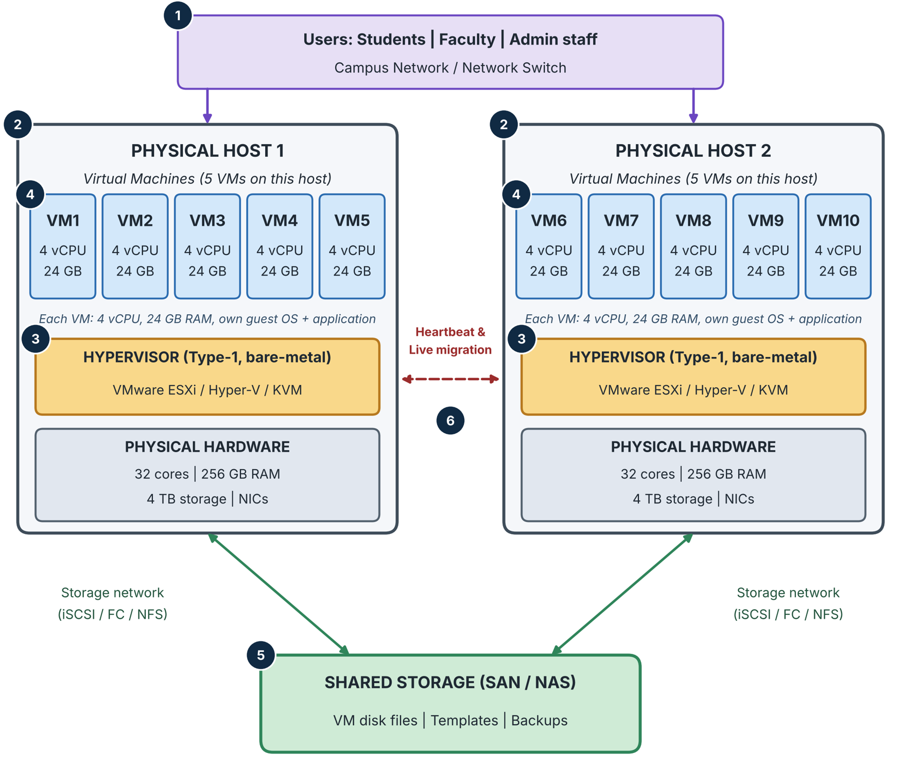

ASSIGNMENT ON

<h1 align="center">CLOUD COMPUTING AND VIRTUALIZATION</h1>

<b>Subject:</b> AIT 
<b>Subject Code:</b> ____________________ 
<b>Assignment No.:</b> I (Scenario-Based Assignment) 
<b>Scenario Attempted:</b> Scenario 1 – University Server Consolidation 
<b>Semester:</b> 1st

<i>Submitted in partial fulfilment of course requirements</i>

<i>Submitted by:</i> 
<b>MADHURJYA BARUAH</b> 
Enrolment No.: CS26MCAGN014

<i>Submitted to:</i> 
<b>DR. SIDDHARTHA ADHYAPOK</b> 
Designation: ____________________ 
School of Computing Sciences

Date of Submission: ____________________

<b>Department of Information Technology</b> 
<b>Master of Computer Applications</b> 
<b>The Assam Kaziranga University, Jorhat, Assam</b> 
<b>November 2026</b>

---

# Scenario 1: University Server Consolidation

## Introduction

ABC University runs **ten physical servers** for its admission portal, Learning Management System (LMS), student database, online examination system, digital library and faculty management system. Most of these servers use only **15–25% of their CPU**. Because of this, the university is paying a lot for electricity, cooling, hardware and maintenance.

The university has decided to use **server virtualization**. It will move all applications into **ten virtual machines (VMs)** running on **two physical hosts**.

### Given data

| Item | Value |
|-----------------------------------|-----------------------------------------------------------------|
| Existing physical servers | 10 |
| Average CPU use of old servers | 15–25% |
| Physical hosts planned | 2 |
| Each host | 32 physical cores, 256 GB RAM, 4 TB storage |
| Number of VMs | 10 |
| Each VM | 4 virtual CPU (vCPU) cores, 24 GB RAM |

<!--
### Basic terms used in this assignment

| Term | Simple meaning |
|----------------------|------------------------------------------------------------------------------|
| **Virtualization** | Technology that makes one physical computer work like many separate computers. |
| **Host** | The real physical server on which VMs run. |
| **Hypervisor** | Software that creates and runs VMs and shares the host's CPU, RAM and storage among them. Examples: VMware ESXi, Microsoft Hyper-V, KVM. |
| **Virtual Machine (VM)** | A virtual computer with its own operating system and application, running on a host. |
| **vCPU** | The virtual CPU given to a VM. The hypervisor runs it on the host's physical cores by sharing time. |
-->

---

## Question 1: Major problems in the existing infrastructure and how virtualization solves them

### (a) Major problems

| No. | Problem | Explanation |
|------|----------------------------|------------------------------------------------------------------|
| 1 | **Very low CPU use (15–25%)** | Each server is bought for peak load, but it stays idle most of the time. The money spent on hardware is wasted. |
| 2 | **High electricity consumption** | All 10 servers run 24 × 7. Even a lightly used server consumes a large part of its full power. |
| 3 | **More cooling and space needed** | Every server produces heat, so more AC load is needed in the server room. Ten machines also need more racks and floor space. |
| 4 | **High hardware cost** | The university must buy 10 servers, and also pay for spare parts, warranty/AMC and replacement after some years. |
| 5 | **Heavy maintenance workload** | The IT staff must patch, repair, monitor and take backup of 10 separate machines. |
| 6 | **Poor flexibility and weak failover** | One application = one server. If a server fails, that application stays down until it is repaired. A new application needs a new server, which takes weeks to buy and set up. |

**Calculation of wasted capacity** (assuming all ten servers have the same capacity):

- Useful work done = 10 × 15% = **1.5 servers** to 10 × 25% = **2.5 servers**
- Unused capacity = 10 − 2.5 = **7.5 servers** to 10 − 1.5 = **8.5 servers**
- In percentage = **75% to 85%** of the total capacity is wasted.

So the work of only about 2 servers is running on 10 machines.

### (b) How server virtualization solves these problems

| Problem | How virtualization helps |
|-------------------------|---------------------------------------------------------------------------|
| Low CPU use | Many VMs share the same host, so the CPU is used much better. The work of 10 servers can run on 2 hosts. |
| Electricity | Only 2 machines run instead of 10, so power consumption falls. |
| Cooling and space | Less heat is produced and fewer racks are needed. |
| Hardware cost | The university buys 2 strong hosts instead of 10 servers. For a new application, it just creates a new VM (no new hardware, until the host is full). |
| Maintenance | There are fewer physical machines. All VMs are managed from one console, and snapshots, templates and backups are easy. |
| Flexibility and failover | A new VM can be created in minutes from a template. If a host fails, its VMs can restart on the other host (high availability), and VMs can be moved between hosts without stopping them (live migration). |

**Extra benefit – isolation:** Every application gets its own VM. If the exam VM crashes, the LMS VM keeps working.

**Reduction in physical servers** = (10 − 2) ÷ 10 × 100 = **80% fewer machines**.

### Real-world examples

- Many colleges and companies run their LMS (for example, Moodle) inside VMs on platforms like VMware vSphere, Microsoft Hyper-V or Proxmox.
- Cloud services like **Amazon EC2** give customers virtual machines that run on shared hardware in data centres. This is the same idea as our university plan.
- **Simple example:** Ten small shops, each in its own building, need ten electricity connections, ten ACs and ten security guards. If the same shops move into one mall, they share electricity, AC and security. Virtualization works in the same way for servers.

---

## Question 2: Total vCPU and RAM requested, and can all ten VMs run on one host?

### Step 1: Total vCPU requested

Total vCPU = Number of VMs × vCPU per VM\
= 10 × 4\
= **40 vCPU**

### Step 2: Total RAM requested

Total RAM = Number of VMs × RAM per VM\
= 10 × 24 GB\
= **240 GB**

### Step 3: Compare with one physical host

| Resource | Needed by 10 VMs | One host has | Difference | Result |
|-----------|----------------------|-------------------|--------------------|----------------------------|
| CPU | 10 × 4 = **40 vCPU** | 32 physical cores | 40 − 32 = **8 more** | Oversubscribed: 40 ÷ 32 = **1.25 : 1** |
| RAM | 10 × 24 = **240 GB** | 256 GB | 256 − 240 = **16 GB left** | 240 ÷ 256 × 100 = **93.75% used** |
| Storage | Not given in the question | 4 TB | – | Cannot be checked |

### Step 4: Explanation

**RAM:** 240 GB is less than 256 GB, so the RAM requirement fits. But only 16 GB is left for the hypervisor and its overheads. This is very tight.

**CPU:** The VMs ask for 40 vCPU but the host has only 32 physical cores. A **vCPU is not a dedicated core**. The hypervisor gives CPU time to the vCPUs in turns, so more vCPUs than cores is allowed. This is called **CPU oversubscription**. Here it is 1.25 : 1.

This is acceptable on normal days because the servers use only 15–25% of CPU. If the new VMs behave the same way:

- Minimum real CPU use = 40 × 15% = **6 cores**
- Maximum real CPU use = 40 × 25% = **10 cores**
- Both are far below the 32 cores available.

> *Example:* It is like a computer lab with 32 systems and 40 students enrolled. If students come in different time slots, everyone gets a system. But if all 40 come together (peak time), some must wait.
>
> *Note:* If hyper-threading is ON, 32 cores usually appear as 64 logical processors, which gives extra room. We count only physical cores here, to be safe.

### Answer

- **If every vCPU needs its own physical core (no oversubscription):** No, because 40 > 32.
- **With normal virtualization (oversubscription allowed):** **Yes, technically all ten VMs can be hosted on one server**, because RAM fits (240 GB ≤ 256 GB) and real CPU use is low.
- **But it is not recommended**, because:
    1. RAM is 93.75% allocated and only 16 GB is left, so there is no room for growth.
    2. At peak time (admission deadline, online exams) many VMs may become busy together and the CPU will become a bottleneck.
    3. It becomes a **single point of failure**. If the host fails, all ten systems go down.

### Better plan: two hosts, five VMs each

| Resource | Per host (5 VMs) | Host capacity | Use |
|------------|----------------------------|--------------------|----------------------------------------|
| vCPU | 5 × 4 = **20** | 32 cores | 20 ÷ 32 = **0.625 : 1** (62.5%, no oversubscription) |
| RAM | 5 × 24 = **120 GB** | 256 GB | 120 ÷ 256 × 100 = **46.9%** used, 136 GB free |

If one host fails, the other host can run all 10 VMs for some time (240 GB ≤ 256 GB RAM and 1.25 : 1 CPU). So two hosts give both **performance** and **safety**.

---

## Question 3: Labelled diagram

**Fig. 1: Virtualized server setup of ABC University (2 physical hosts, 10 VMs and shared storage)**

### Explanation of the labels

| No. | Part | Explanation |
|------|--------------------------|--------------------------------------------------------------------|
| 1 | **Users and network switch** | Students, faculty and staff reach the applications through the campus network and switch. |
| 2 | **Physical Host 1 and Host 2** | Real servers. Each has 32 cores, 256 GB RAM and 4 TB storage. |
| 3 | **Hypervisor** | Installed directly on the hardware (Type-1 or bare-metal hypervisor, e.g. VMware ESXi, Hyper-V, KVM). It creates the VMs and shares CPU and RAM among them. |
| 4 | **Virtual Machines** | 5 VMs per host (VM1–VM5 on Host 1, VM6–VM10 on Host 2). Each has 4 vCPU, 24 GB RAM, its own guest OS and application. |
| 5 | **Shared storage (SAN / NAS)** | Keeps the VM disk files, templates and backups. Both hosts can reach it, so a VM can start on the other host if one host fails. |
| 6 | **Link between the hosts** | Used for heartbeat (checking that the other host is alive) and live migration of VMs. |

**Note:** The 10 VMs run the six systems of the university (admission portal, LMS, student database, online examination, digital library and faculty management). Some systems may use more than one VM, for example a web server VM and a database VM.

**How it works:** A user request comes through the network to a VM. The VM runs on a host through the hypervisor. The VM's data is stored on the shared storage. If Host 1 fails, the hypervisor software restarts its VMs on Host 2, because their disks are on the shared storage.

---

## Question 4: Two risks of running multiple VMs on the same host and their solutions

### Risk 1: Single point of failure (host failure)

**Problem:** Many VMs depend on one physical host. If the host has a hardware failure (power supply, motherboard, RAM) or loses power, **all VMs on it stop together**.

*Example:* If Host 1 fails during the admission period, five VMs (for example, the admission portal and LMS) go down at the same time. It is like a building with only one lift: if the lift stops, nobody can go up.

**Solutions:**

1. **Hypervisor cluster with High Availability (HA):** Join Host 1 and Host 2 in a cluster with shared storage. If one host fails, the other host automatically restarts the VMs. (Examples: VMware vSphere HA, Hyper-V Failover Cluster, Proxmox HA.)
2. **Keep spare capacity:** The surviving host must be able to run all the VMs. As calculated in Question 2, 240 GB ≤ 256 GB, so this works. More RAM can be added for extra safety.
3. **Spread related VMs on different hosts:** Keep the web VM and database VM of the same system on different hosts, so one failure does not stop the whole system.
4. **Regular backups and hardware protection:** Take regular VM backups and test the restore. Use UPS, dual power supply, RAID disks and two network cards.

### Risk 2: Resource contention ("noisy neighbour" problem)

**Problem:** All VMs share the same CPU, RAM, disk and network of the host. If one VM uses too much, the other VMs become slow.

*Example:* During the online exam, the exam VM uses almost all the CPU. At the same time, the LMS and digital library VMs become slow. It is like a hostel where one student downloads heavy files and the Wi-Fi becomes slow for everyone.

**Solutions:**

1. **Set resource limits, reservations and shares:** Give a guaranteed minimum CPU and RAM to important VMs (like the exam system) and set a maximum limit for the others.
2. **Do not over-commit:** Keep the oversubscription low. In our plan, CPU is only 0.625 : 1 per host and RAM is not over-committed.
3. **Monitoring and alerts:** Watch CPU, RAM, disk and network use of every VM. Send an alert when use goes above a limit (for example, 80%).
4. **Automatic load balancing / live migration:** If a host becomes too busy, move a VM to the other host without stopping it. (Examples: VMware DRS and vMotion, Hyper-V Live Migration.)

### Summary of risks and solutions

| Risk | Main solution |
|------------------------------|----------------------------------------------------------------------|
| Single point of failure | Two-host cluster with HA, shared storage, spare capacity, backups |
| Resource contention | Resource limits and reservations, monitoring, load balancing, no over-commitment |

---

## Conclusion

The old setup of 10 servers wastes about 75–85% of its CPU capacity and increases the cost of electricity, cooling, hardware and maintenance. Server virtualization solves this by running the same applications on two physical hosts, which is **80% fewer machines**. The ten VMs ask for **40 vCPU and 240 GB RAM**. One host *can* run all of them only by CPU oversubscription and with very little spare RAM, so it is not advisable. Using **two hosts with five VMs each, a shared storage and HA** gives better performance, safety and easy management for the university.

---

## References

1. R. Buyya, C. Vecchiola, S. T. Selvi, *Mastering Cloud Computing: Foundations and Applications Programming*, McGraw-Hill Education.
2. T. Erl, R. Puttini, Z. Mahmood, *Cloud Computing: Concepts, Technology & Architecture*, Prentice Hall.
3. Product documentation of VMware vSphere, Microsoft Hyper-V and Proxmox VE (for hypervisor, HA and live migration features).
